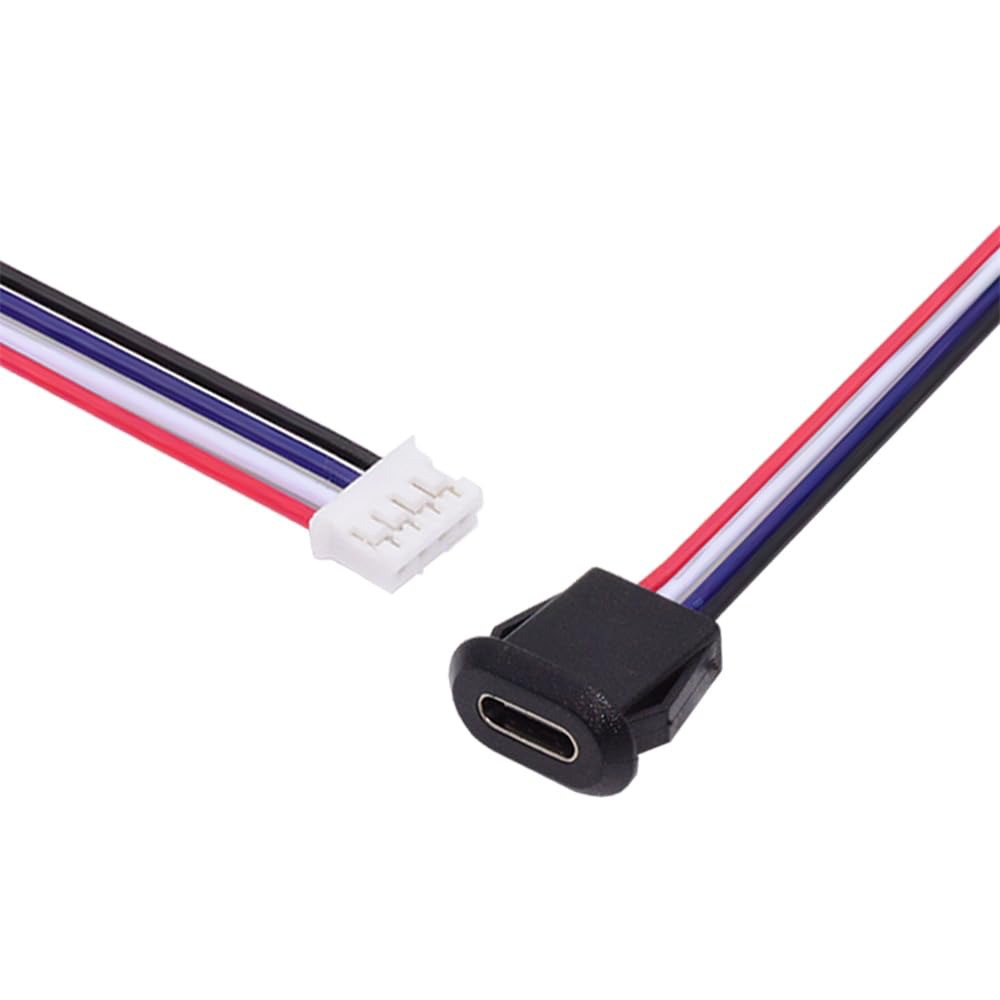

# Local ESPHome control for the Vivosun AeroZesh T8 EC fan

Run a Vivosun AeroZesh T8 8" EC inline duct fan from ESPHome and Home Assistant,
with no GrowHub controller, no app, and no cloud. Continuous speed control
instead of ten fixed steps.

The stock GrowHub controller talks to Vivosun's cloud over AWS IoT and offers ten
discrete speed levels with no documented local API. The fan itself does not care:
it takes a simple analog level on one wire.

## The one thing that will bite you

The fan's control line **pulls itself up to 12 V internally**. A floating or
disconnected control line means **full speed** — that is the fan's failsafe, and
it is why "stuck at full, ignores every setting" is the classic symptom.

Two settings in the config exist because of that, and neither is optional:

- `inverted: true` — the MOSFET output is open-drain, so 0 % duty leaves the line
  high. Omit this and the fan runs full and appears unresponsive.
- `zero_means_zero: true` — otherwise `min_power` applies to "off" too, and the
  fan idles at 35 % forever.

## How the fan actually behaves

Measured on the bench, driving the control line directly:

| Property | Value |
|---|---|
| Control input | Analog level the fan integrates: 0 V = off, ~12 V = full |
| Input impedance | High-Z, draws essentially no current |
| Response | **Continuous**, not internally quantised |
| Floating line | Pulled to 12 V = full speed (failsafe) |
| Minimum duty to start | ~35 % (stops around 27 % descending — there is hysteresis) |
| Full speed | ~3250 RPM, ~50 dB |
| Quietest usable | ~25 dB at the bottom of the min-speed shelf |
| Duct collars | 197 mm ID — nominal 8" duct and clamps fit over them |

Because the input is high impedance and integrating, it will faithfully follow
noise. **Drive it from a low-impedance source.** A MOSFET switching at 12 kHz is
steady. A resistive divider or digital potentiometer is not — its output picks up
ripple that the fan tracks, and the fan hunts. That is a property of the source,
not of PWM.

Never PWM the fan's 12 V supply rail. EC fans need constant power; speed is the
separate signal line.

## Parts

| Qty | Item | Notes |
|---|---|---|
| 1 | Vivosun AeroZesh T8 8" EC inline duct fan | The GrowHub controller is not needed and is not used |
| 1 | ESP32 dev board | Any. The reference build used a vdbx FLIP_C3 (ESP32-C3) |
| 1 | Low-side MOSFET module, "XY-MOS" style — [example](https://www.amazon.com/dp/B0DZP27C2N) | The entire driver. PWM in, open-drain out, screw terminals |
| 1 | USB-C receptacle to 4-pin pigtail — [example](https://www.amazon.com/dp/B0D7CN4BTV) | Taps the fan's four conductors without cutting its cable |
| 1 | 12 V → 5 V step-down (MP1584, Mini360, LM2596) | Only if your ESP board has no wide-input regulator — see [Powering the ESP](#powering-the-esp) |
| — | Hookup wire, heat shrink, a small enclosure | Whatever you already have |

No custom PCB, and depending on your board and module, possibly no soldering —
the MOSFET module's power and output connections are screw terminals.

## Tapping into the fan

The fan's control tail ends in a **USB-C connector, which is not USB**. It is a
repurposed connector carrying 12 V and the control signal. Do not plug the fan
into anything expecting USB, and do not expect a USB cable to pass the right
conductors.

The clean way in is a USB-C-receptacle-to-4-pin pigtail, which breaks the four
conductors out without cutting the fan's cable:



The one used here: [Xiwai USB-C female waterproof terminal pigtail](https://www.amazon.com/dp/B0D7CN4BTV).

### Wire colours

| Wire | Function |
|---|---|
| **Red** | +12 V, supplied *by* the fan |
| **Black** | Ground |
| **Blue** | Control signal (this is the one you drive) |
| **White** | Tach / RPM out — see [known limitations](#known-limitations) |

Colours are for the pigtail above. Meter yours before trusting it: the +12 V and
ground pair is obvious with the fan powered, and the control line is the one that
sits near 12 V when nothing is driving it.

## Wiring

Low-side MOSFET module between the ESP and the fan:

| Module terminal | Connects to | Notes |
|---|---|---|
| GND | ESP GND | Reference for the PWM input |
| PWM | ESP `GPIO7` | Any non-strapping GPIO |
| IN+ | **Red** (fan +12 V) | Must read a stiff ~12 V |
| IN− | **Black** (fan ground) | Common ground |
| OUT+ | *not connected* | Passthrough of IN+, unused |
| OUT− | **Blue** (fan control) | Open-drain; the fan supplies the high level |

The **white** tach wire goes nowhere unless you are attempting RPM. Leave it
insulated and parked.

Full build notes and the failure signatures worth recognising: [docs/wiring.md](docs/wiring.md).

## Powering the ESP

The red wire gives you 12 V, which is what the MOSFET module's IN+ wants and what
your ESP board almost certainly does not. Unless your board has a wide-input
regulator, step it down. Whatever you choose, the ESP ground, the module's GND and
IN−, and the fan's black wire all have to be the same ground.

| Option | Notes |
|---|---|
| Small buck module (MP1584, Mini360, LM2596) | 12 V from the red wire in, 5 V out to the ESP's 5 V/VIN pin. Cheap, tiny, and what most builds use. Set the output before connecting it to the ESP if the module is the adjustable kind. |
| ESP board with a wide-input regulator | Some dev boards accept 6–24 V on VIN directly. Check the board's datasheet rather than the seller's listing — plenty of boards label a pin "VIN" and mean 5 V. |
| Separate USB supply | Power the ESP from any USB adapter and take only the control and ground connections from the fan. Simplest during bring-up. You must still bond the ESP ground to the fan's black wire or the PWM signal has no reference. |
| 12 V automotive USB adapter | A 12 V-to-USB socket adapter fed from the red wire. Bulkier, but no soldering and the regulation is usually decent. |

The whole controller draws well under a watt, so current capacity is not a
constraint — any of these has ample headroom. A linear regulator would also work
electrically but wastes the difference as heat for no benefit.

## Quick start

1. Wire it per the table above and confirm IN+ reads a stiff ~12 V before flashing.
2. Copy `esphome/vivosun-t8-fan.yaml` next to your device configs.
3. Include it and set your pin and name:

   ```yaml
   packages:
     t8_fan: !include vivosun-t8-fan.yaml

   substitutions:
     t8_fan_name: "Annex Exhaust"
     t8_pwm_pin: GPIO7
   ```

4. Add your own `esphome:` / `esp32:` / `wifi:` / `api:` / `ota:` blocks — this
   package deliberately contains none of that. `esphome/example-device.yaml`
   shows the shape.
5. Flash, then sweep the speed and check the numbers against your own fan
   ([docs/calibration.md](docs/calibration.md)).

## Speed curve

With `min_power: 0.35`:

| Home Assistant % | Behaviour |
|---|---|
| 1–25 % | Flat minimum-speed shelf — ~780 RPM, ~25 dB. No fine control *within* the shelf; that is the fan's floor. |
| 25–100 % | Real ramp up to ~3250 RPM, ~50 dB |

## Known limitations

**RPM / tachometer does not work well.** The config ships with the tach block
commented out. It may work for you — the signal is there on the white wire — but here it
over-reported badly at low speed, where the higher density of PWM switching edges
couples into the pulse counter. pulse_meter, the ISR counter, a 3 ms software
filter, and relocating the tach pin each traded one failure mode for another.
Speed control is unaffected. If you need airflow feedback, an anemometer reading
is more trustworthy than this tach.

**The percentages are from one fan.** Start point, not gospel.

## What was tried and rejected

- **Digital potentiometer (DS3502) as a divider on the 12 V line** — worked, but
  hunted. Its ~2.5 kΩ output is high impedance and the fan's integrating input
  followed the ripple. Abandoned.
- **DAC plus op-amp buffer** — designed to give stiff DC, never built. Once the
  drive was low impedance via a MOSFET, the buffer was unnecessary.

A plain MOSFET plus LEDC PWM worked immediately. Try that first.

## Repository layout

```
esphome/vivosun-t8-fan.yaml   drop-in package: output + fan + presets
esphome/example-device.yaml   minimal consuming example
docs/wiring.md                build detail, bring-up faults
docs/calibration.md           characterising your own fan
docs/images/                  reference photos
```

## Compatibility

Developed against an ESP32-C3 with ESPHome 2026.6.x. Nothing in the package is
C3-specific beyond the strapping-pin warning; any ESP32 or ESP8266 with an LEDC
(or `esp8266_pwm`) output should work.

## Credit

Not a fork, but the inspiration and the starting point for understanding these
fans: [billjuv/EC_Fan_ESPHome](https://github.com/billjuv/EC_Fan_ESPHome), a
purpose-built ESP32 board for 4-wire EC fans.

**It did not work on this fan.** Wired to a T8 it hunted — several attempts, never
a steady speed. The likely reason, though this was not proven on that board: it
drives the control line from an open-collector stage through a pull-up resistor,
which is a relatively high-impedance source feeding an input that integrates
whatever ripple reaches it. That is the same failure mode a digipot divider
produced here later, and it is why this project drives the line from a MOSFET
instead. Results on an AC Infinity fan may well be different.

So the approach here is the opposite one: a generic ESP board and an off-the-shelf
MOSFET module, low impedance, no custom hardware.

## License

MIT — see [LICENSE](LICENSE).

## Version

1.0.0 — 2026-08-11
