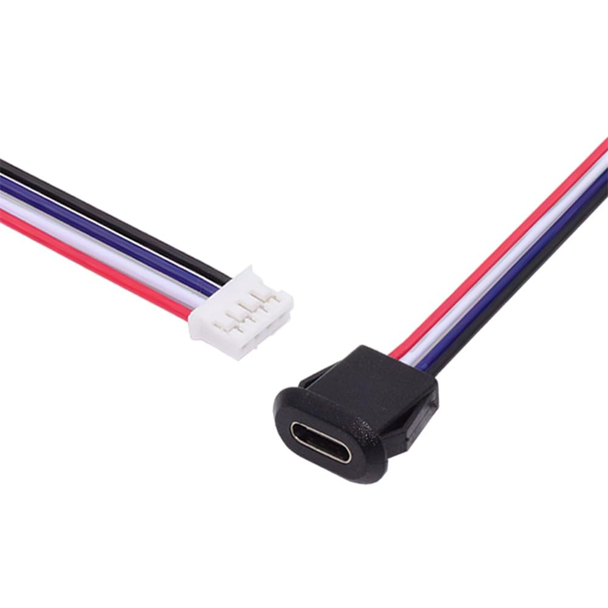

# Wiring and bring-up

Version 1.0.0

## What you need

The parts list with links lives in the [README](../README.md#parts). Two points
from it worth repeating: the fan supplies its own 12 V, so no separate PSU is
required, and the MOSFET module should be rated to at least 20 kHz because the
config switches at 12 kHz.

## The fan's connector

The fan's control tail ends in a **USB-C connector that is not USB**. It carries
12 V and the control signal on a repurposed connector. Break it out with a USB-C
receptacle pigtail rather than cutting the fan's own cable:

| Wire | Function |
|---|---|
| Red | +12 V out, supplied by the fan |
| Black | Ground |
| Blue | Control — analog level in, 0 V = off, ~12 V = full |
| White | Tach out, open collector |

Colours are for the pigtail linked above; confirm yours with a meter. The 12 V
comes *from* the fan — it powers your controller, not the other way around. Step
it down for the ESP as described in the README.

## MOSFET module connections

| Module terminal | Connects to | Notes |
|---|---|---|
| GND | ESP GND | Reference for the PWM input signal |
| PWM | ESP GPIO (default `GPIO7`) | Non-strapping pin only |
| IN+ | Red | Powers the module's gate-drive stage — must be a stiff ~12 V |
| IN− | Black | Establishes the common ground |
| OUT+ | no connection | IN+ passthrough, unused here |
| OUT− | Blue | Open-drain output; the fan's internal pull-up supplies the high level |

The white tach wire is unused unless you are attempting RPM.

## Pin selection

On an ESP32-C3, GPIO8 and GPIO9 are strapping pins. A module connected to one of
them can hold it low at reset and drop the board into serial download mode
(`boot:0x4 (DOWNLOAD)`) on every cold power-up. This is read by the ROM before
any firmware runs, so reflashing appears to fix it — esptool's controlled reset
releases the strap — and then the next power cycle traps it again. Pick a
different pin rather than chasing it.

## Bring-up faults worth recognising

**IN+ reads about 6 V and mirrors OUT−, and the fan sits at mid speed no matter
what you command.** The module's supply path is not landed. It is back-feeding
itself from the control line through its output network, so the MOSFET gets
partial gate drive and sits in its linear region. IN+ should always read a stiff
~12 V. Land IN+ to the red wire and IN− to the black wire properly.

**The fan runs full and ignores everything.** The control line is floating. Either
OUT− is not actually connected to the blue wire, or `inverted: true` is missing from the
LEDC output. Both produce an identical symptom because both leave the line high.

**The fan runs at its floor speed when commanded off.** `zero_means_zero: true`
is missing, so `min_power` is being applied to the off state.

**The fan speed wanders on its own.** Your drive source is too high impedance. The
fan's control input integrates whatever it is given, including ripple. A divider
or digipot output will do this; a MOSFET will not. Check with a meter in AC volts
mode on the control pin — a clean source reads near zero there.

## Failsafe behaviour

A dead ESP, a disconnected GPIO, or a static pin leaves the control line floating,
which the fan reads as full speed. For an exhaust fan that is a benign failure
mode. Bear it in mind if you repurpose this for something where full speed is not
the safe state.

## Alternative driver, if you have one on the shelf

A spare RGBW LED controller channel works — the channel only sinks the line.
Connect the channel output to the blue wire and bond the controller's ground to
the black wire.
Bond grounds only; never tie two +12 V rails together. The other supply's exact
voltage does not matter because the channel is sink-only.
